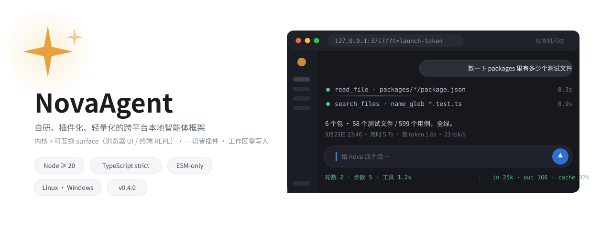
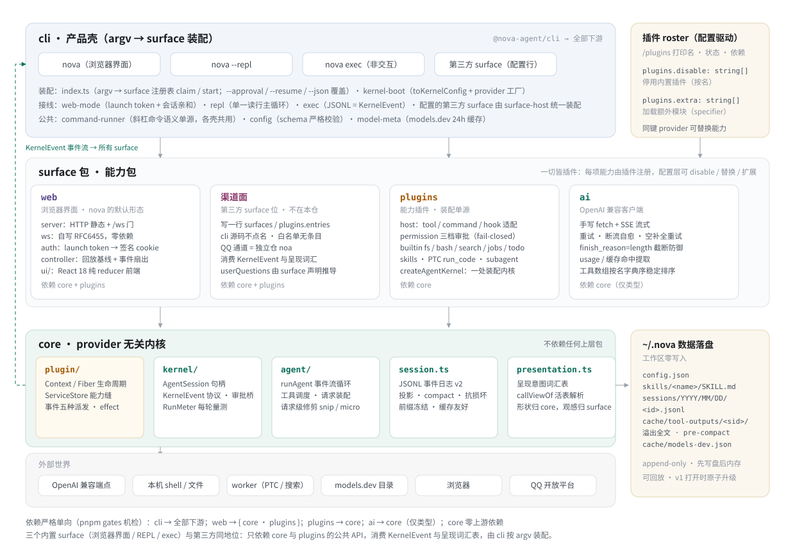
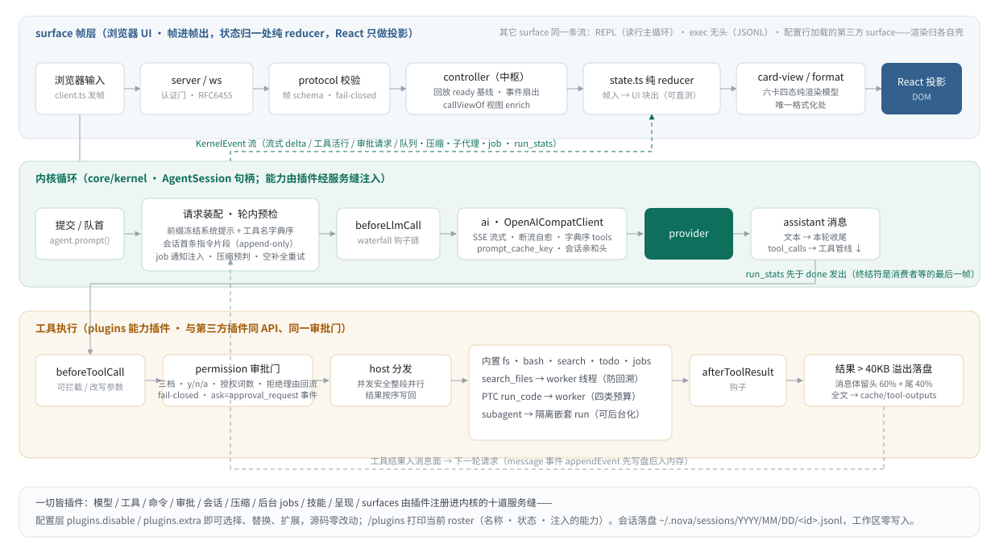
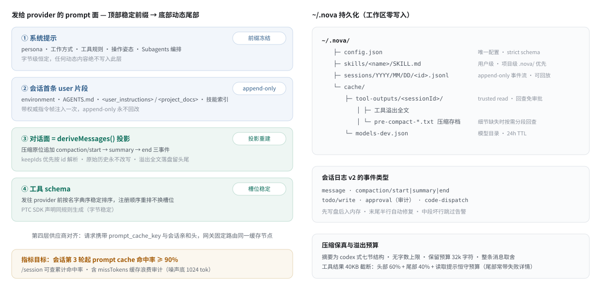

# NovaAgent

自研、插件化、轻量化的跨平台本地智能体框架——一个在**当前工作目录**运行的 agent 运行时：通过任意 OpenAI 兼容端点对接模型，内核收拢为**插件容器 + 事件流句柄**（`Context` / `AgentSession` / `KernelEvent`），工具、斜杠命令、生命周期钩子、Skills 与**能力服务**全部经插件注册，界面只是同一内核事件流的消费者（桌面窗口 / readline / headless 地位相同；渠道型 surface 如 QQ 由独立包按配置行接入，不随本仓发行）。所有数据（配置 / 会话 / 缓存 / 技能）集中在 `~/.nova/` 下，**运行目录零写入**。


> 完整设计、约定与里程碑见 [AGENTS.md](./AGENTS.md)（人机共读的**唯一权威文档**）；版本号遵循 [Semantic Versioning 2.0.0](https://semver.org/lang/zh-CN/)，公共 API 定义见其 §8。

## 快速开始

```bash
pnpm install
pnpm build
pnpm nova            # 裸起运行时：stdout 是帧通道，等桌面壳（或你）喂 JSON 行
```

配置写在 `~/.nova/config.json`（唯一来源，`apiKey` 支持 `{env:NAME}` 引用环境变量）：

```jsonc
{
  "provider": {
    "baseURL": "https://api.example.com/v1",
    "apiKey": "{env:MY_KEY}",
    "model": "model-name"
  },
  "approval": "read-only",          // read-only | auto-edit | full
  "plugins": {                       // 配置层的能力选择与扩展：不改源码即可增删能力
    "entries": [
      { "id": "todo", "enabled": false },   // 关掉内置插件
      { "id": "./my-plugin.mjs" }           // 加载自己写的插件
    ]
  }
}
```

任意 OpenAI 兼容端点均可对接——填好 `baseURL` 与 `model` 即跑。之后：

```bash
pnpm nova                          # 裸起运行时（由桌面壳托管时无需手动执行）
nova --repl                        # 只用终端（readline）
nova -- --approval auto-edit       # 临时覆盖审批档位
nova -- --resume ~/.nova/sessions/2026/09/23/<id>.jsonl
nova exec "修复测试" --json         # 非交互单次执行（JSONL 事件流，CI 友好）
```

## 形态与架构

| Surface | 形态 | 说明 |
| --- | --- | --- |
| **桌面窗口**（默认） | `nova` | Tauri 2 壳（`apps/tauri-bench`）起 `node` 子进程，**stdout/stdin 即帧通道**（逐行 JSON，`exec --json` 是同款先例）；界面由 `frontendDist` 打进 exe，因此**无端口、无 URL、无 cookie**。前端 React 18 + Next.js 静态导出（`output: 'export'`，Next 只做构建工具），状态归一处纯 reducer，视觉为 Nova 自研设计语言（三层 token / 明暗双档 / 三栏 AppFrame 几何，右栏按需展开 / composer 胶囊 / 真 diff 工具卡） |
| readline REPL | `nova --repl` | 终端最低保障（显式指定才用）：斜杠命令、审批 y/n/a + 拒绝理由、流式进度行 |
| headless | `nova exec --json` | 非交互单次执行，`KernelEvent` JSONL 事件流，never 审批（未放行即拒绝） |
| 渠道面（QQ 等） | 配置行加载 | 不在本仓：渠道包自己一个仓库（QQ 通道＝ [noa](../../noa)），写一行 `surfaces` / `plugins.entries` 即接入，cli 源码不点名 |



八个包（**八个**全部受依赖白名单管辖）、依赖严格单向（`pnpm gates` 机检）：`core`（内核 + 插件容器，零上游）← `ai` / `plugins` ← `web` ← `cli`（唯一 IO 与装配点）；`plugin-subagent` / `plugin-context` / `plugin-ptc` 是三个 advanced 档扩展包（默认关，按 spec 装载，只依赖 `core`）。内核装配收口在 `plugins` 的 `createAgentKernel()`，**有三个调用点**：cli 的 `bootKernel()`（exec / repl 与配置加载的渠道面经它装配）、`packages/web` 的 `WebController.create()`、以及 `packages/cli/src/surface-host.ts` 的 `buildSurfaceRuntime()`（任何动态 surface 插件经它装配）。后两者**自己装配、不经 `bootKernel`**——桌面面需要 `modelCatalog` 与 provider 的模型标签/窗口，动态 surface 需要装配期间的 holder 绑定，两者 `BootOptions` 都装不下。所以「`nova` 默认形态走 `bootKernel`」是错的：默认形态恰恰是绕过它的那个。**有一个装配项需要每个 surface 都在场**：`userQuestions`（默认 false 且 fail-closed），否则 `ask_user_question` 只会回模型一句「没有接收者」——工具在、UI 在、提问永远不发生。动态 surface 由 `buildSurfaceRuntime` 从 `surface.answersQuestions ?? surface.interactive` 推导，不用手抄。

- **一切皆插件**：工具 / 命令 / 钩子 / 能力服务（approval、llm、sessions、compaction、jobs、spill、skills、tools、commands）全部经 Cordis 式容器注册，可按键替换；插件树是**单一 `plugins.entries` 列表**，每行 `{ id, enabled?, config? }`，`enabled` 是唯一开关（旧的 `plugins.disable` / `plugins.enable` / `plugins.extra` 三张表已删除——两份能互相矛盾的列表正是「关掉的插件自己复活」的成因），行内 `config` 由该插件自己的 schema 校验收，宿主不认识任何一个插件的字段。
- **运行有迹可循**：`/plugins` 打印插件 roster（名字 / 状态 / 注入的服务）；每次运行都是一条 `KernelEvent` 流，每轮以 `run_stats` 收尾（时长 / 首 token / 吞吐 / 缓存命中）。
- **稳定前缀 = 高缓存命中**：系统提示字节稳定，动态内容按 append-only 注入会话首条片段；请求级修剪（snip/micro）+ 原位压缩 + 供应商会话亲和头。





## 常用脚本

```bash
pnpm test           # vitest（无网络：ai 层注入 fetch + SSE fixture）
pnpm verify         # build + typecheck + test + gates（提交前）
pnpm check          # lint + gates + 变更相关测试（秒级快环）
pnpm smoke:desktop  # 真机冒烟桌面管道（走真 provider，8 项）
```

## 许可

MIT
